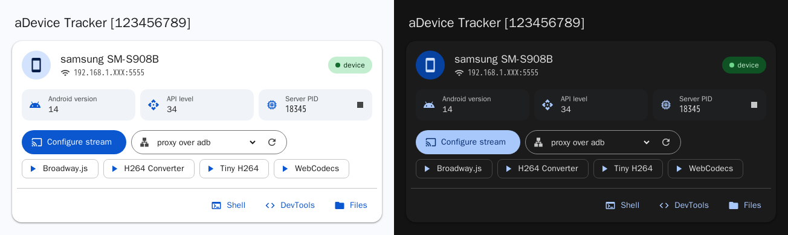
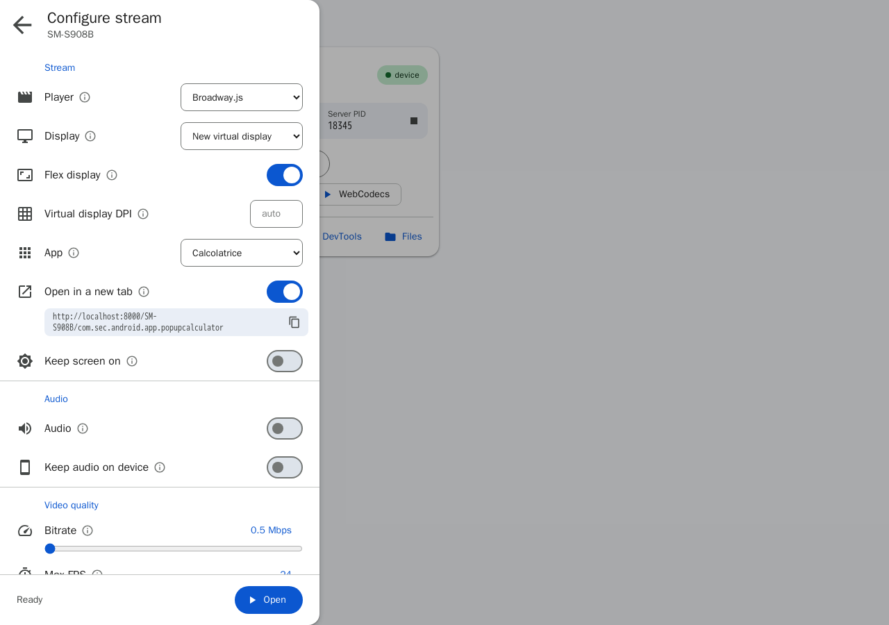
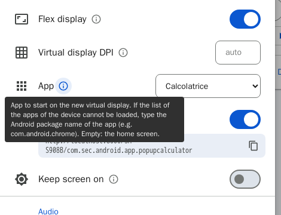
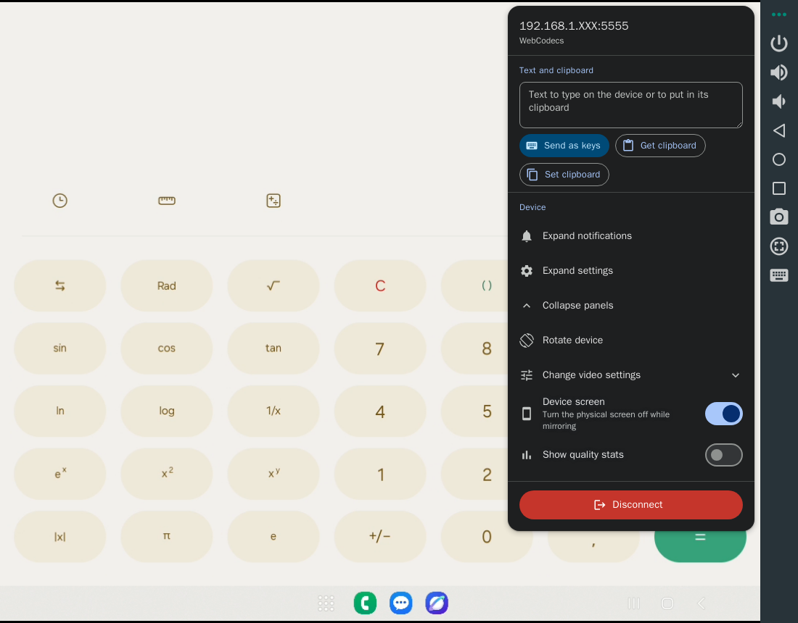

# ws-scrcpy-plus

> **[ws-scrcpy-plus][repo] is a fork of [NetrisTV/ws-scrcpy][upstream]**, the original web client
> for [Genymobile/scrcpy][scrcpy] by NetrisTV. It keeps the same architecture and
> most of the original documentation below, and adds an up-to-date device
> server, a redesigned interface, virtual displays with app launch, shareable
> stream links and a Docker/Podman image. See
> [What's different from the original](#whats-different-from-the-original).

## In short

**ws-scrcpy mirrors and controls Android devices from a web browser.** Connect
your phone to the computer running ws-scrcpy (USB or Wi-Fi debugging), open
`http://<computer>:8000` from any browser on your network, pick the device and
use it: touch, keyboard, clipboard, audio, file transfer, shell and DevTools.

What this fork adds:

* **Shareable stream links** - `http://<computer>:8000/<device>/<package>`
  (e.g. `/SM-S908B/com.android.chrome`) opens the app on a virtual display of the
  device, **creating the stream if it is not running yet** or joining it if it
  is. Configure a stream once, then open the same link from a tablet, another PC
  or a bookmark. See [Shareable stream links](#shareable-stream-links).
* **New virtual display + app launch** - stream a separate virtual screen of
  the device (Android 10+) and choose which installed app starts on it, from the
  real list of the apps of the device. With **flex display** it follows the size
  of the browser window.
* **Up-to-date device server** - official scrcpy **v5.0.1** with a WebSocket
  patch (the original used a scrcpy 1.19 fork): audio forwarding, keep screen
  on, virtual displays.
* **Material 3 interface** - device cards, "Configure stream" side sheet with a
  tooltip for every option, stream menu, light and dark theme, empty states that
  explain what to do.
* **Docker / Podman image** - `docker compose up -d --build` and you are done
  (Android only).

Quick start:

```shell
docker compose up -d --build                                   # or: podman-compose up -d --build
docker compose exec ws-scrcpy adb connect 192.168.1.10:5555    # a device on Wi-Fi debugging
# then open http://localhost:8000
```

### Screenshots

The device list, in the light and dark theme:



"Configure stream": a new virtual display running an app picked from the device,
opened in a new tab through its shareable link:



Every option has a tooltip:



A stream opened from a shareable link (the Calculator app on a virtual display),
with the stream menu:



## What's different from the original

| Area | [NetrisTV/ws-scrcpy][upstream] | This fork |
| --- | --- | --- |
| Device server | scrcpy 1.19 fork with a WebSocket server | Official scrcpy v5.0.1 + a [patch](/scrcpy-server/patches) (`5.0.1-ws3`), rebuilt in a container |
| Displays | Existing displays | Also a **new virtual display** (fixed size or **flex**), with an **app** started on it |
| Links | `#!action=stream&udid=...` links, per player | Also **shareable links** `/<device>/<package>` that create or join the stream |
| Audio | - | Device audio in the browser (Android 11+), optionally kept on the device |
| Keep screen on | - | `scrcpy --keep-active` |
| Interface | Original tables and buttons | Material 3 cards, side sheet with tooltips, stream menu, light/dark theme, empty states for the device list and DevTools |
| Disconnect | Left an empty page | Goes back to the device list |
| Deployment | Node.js on the host | Also a Docker/Podman image with `adb` |
| HTTP API | - | App list and device lookup (see [HTTP API](#http-api)) |

iOS support is the same as upstream (not included in the default build, nor in
the container image).

## Requirements

Browser must support the following technologies:
* WebSockets
* Media Source Extensions and h264 decoding;
* WebWorkers
* WebAssembly

Server (not needed with [Docker / Podman](#docker--podman)):
* Node.js (the container image uses v22)
* node-gyp ([installation](https://github.com/nodejs/node-gyp#installation))
* `adb` executable must be available in the PATH environment variable

Device:
* Android 5.0+ (API 21+)
* Enabled [adb debugging](https://developer.android.com/studio/command-line/adb.html#Enabling)
* On some devices, you also need to enable
[an additional option](https://github.com/Genymobile/scrcpy/issues/70#issuecomment-373286323)
to control it using keyboard and mouse.
* Android 10+ for virtual displays, Android 11+ for audio

## Build and Start

Make sure you have installed [node.js](https://nodejs.org/en/download/),
[node-gyp](https://github.com/nodejs/node-gyp) and
[build tools](https://github.com/nodejs/node-gyp#installation)
```shell
git clone https://github.com/EdoardoPauletto/ws-scrcpy-plus.git
cd ws-scrcpy-plus
npm install
npm start
```

## Docker / Podman

The image bundles Node.js and `adb` (Android only; iOS is not supported in the
container). It builds the app in a first stage and runs `dist/` in a slim image;
the adb server runs inside the container.

```shell
docker compose up -d --build        # Podman: podman-compose up -d --build
```

Then open http://localhost:8000 (or `http://<computer IP>:8000` from another
device of your network).

### Connecting devices

Over Wi-Fi:

```shell
# Android 11+: Developer options -> Wireless debugging -> "Pair device with
# pairing code", then pair and connect from inside the running container
docker compose exec ws-scrcpy adb pair 192.168.1.10:37123 123456
docker compose exec ws-scrcpy adb connect 192.168.1.10:41234

# older Android: run `adb tcpip 5555` once over USB, then
docker compose exec ws-scrcpy adb connect 192.168.1.10:5555

docker compose exec ws-scrcpy adb devices
```

The first time, accept the debugging authorization prompt on the device. The
adb keys are kept in the `adb-keys` volume, so the device stays authorized
across rebuilds; the connections themselves are not: after a restart of the
container or of the host, connect again, or list the devices in `ADB_CONNECT`
to have them connected automatically, e.g. in a `.env` file next to
`docker-compose.yml`:

```shell
ADB_CONNECT=192.168.1.10:5555,192.168.1.11:5555
```

The container keeps retrying in the background (every `ADB_RECONNECT_INTERVAL`
seconds) until they are reachable, and reconnects them whenever they drop off.
This needs a fixed address (a DHCP reservation) and port: `adb tcpip 5555`
gives one, while the port of Android 11+ Wireless debugging changes every time
it is turned on or the device reboots.

Over USB (stop the host adb server first, `adb kill-server`; with rootless
Podman the USB device nodes must also be accessible to your user):

```shell
docker compose -f docker-compose.yml -f docker-compose.usb.yml up -d --build
```

### Configuration

* `ADB_CONNECT` - optional comma-separated `host[:port]` list (default port
`5555`) connected on startup and reconnected when missing or offline (handy for
devices with a fixed address and port)
* `ADB_RECONNECT_INTERVAL` - seconds between those reconnection checks (default
`30`, `0` connects only once at startup)
* `WS_SCRCPY_PORT` - host port to publish (default `8000`)
* to use a [run configuration](#run-configuration), uncomment the
`WS_SCRCPY_CONFIG` lines in `docker-compose.yml`
* [build configuration](#custom-build) overrides are applied at image build

### Podman

The same files work with Podman. Use `podman-compose` (on some systems
`podman compose` delegates to `docker-compose`, which needs a `docker` binary):

```shell
podman-compose up -d --build
podman exec -it ws-scrcpy_ws-scrcpy_1 adb connect 192.168.1.10:5555
podman-compose down          # stop; `up -d --build` again to update
```

### ARM (NAS, Raspberry Pi)

The image builds for `linux/amd64`, `linux/arm64` and `linux/arm/v7` (32-bit
ARM). On ARM, `adb` comes from Debian bookworm-backports.

Building on a slow, low-memory 32-bit device takes long, so build on a PC
instead and copy the image over. Cross-building needs QEMU user emulation on
the PC (e.g. `sudo apt install qemu-user-static` on Debian/Ubuntu); the
JavaScript bundles are still built natively, only `node-pty` and the runtime
packages run emulated:

```shell
# Docker: docker buildx build --platform linux/arm/v7 --load -t ws-scrcpy:armv7 .
podman build --platform linux/arm/v7 -t ws-scrcpy:armv7 .
# on the NAS, tag it with the name docker-compose.yml expects (Docker: docker load / docker tag)
podman save ws-scrcpy:armv7 | ssh user@nas 'podman load && podman tag localhost/ws-scrcpy:armv7 ws-scrcpy:local'
```

Then on the NAS, next to `docker-compose.yml`: `podman-compose up -d` (or
`docker compose up -d`), without `--build`, which uses the copied image.
Building directly on the NAS (`up -d --build`) also works, just slowly.

If the container hangs or fails right away on a 32-bit ARM host (wrong dates,
`apt`/`node` stuck or erroring with "Operation not permitted"), the host's
Docker/libseccomp is too old for the 64-bit time syscalls of current
distributions: update it, or uncomment `security_opt: seccomp=unconfined` in
`docker-compose.yml`.

## Supported features

### Android

#### Device list and configuration
Each device is a card with its name, serial or IP address, Android version,
API level and the state of the device server, and the actions: **Configure
stream**, direct links for each player, Shell, DevTools and Files. When no
device is connected, the page explains how to connect one.

**Configure stream** opens a side sheet with all the stream options (player,
display, virtual display, app, audio, quality, size, encoder); the ⓘ button of
each option explains it. The settings can be saved per player and display.

#### Screen casting
The modified [version][fork] of [Genymobile/scrcpy][scrcpy] used to stream
H264-video, which then decoded by one of included decoders:

##### Mse Player

Based on [xevokk/h264-converter][xevokk/h264-converter].
HTML5 Video.<br>
Requires [Media Source API][MSE] and `video/mp4; codecs="avc1.42E01E"`
[support][isTypeSupported]. Creates mp4 containers from NALU, received from a
device, then feeds them to [MediaSource][MediaSource]. In theory, it can use
hardware acceleration.

##### Broadway Player

Based on [mbebenita/Broadway][broadway] and
[131/h264-live-player][h264-live-player].<br>
Software video-decoder compiled into wasm-module.
Requires [WebAssembly][wasm] and preferably [WebGL][webgl] support.

##### TinyH264 Player

Based on [udevbe/tinyh264][tinyh264].<br>
Software video-decoder compiled into wasm-module. A slightly updated version of
[mbebenita/Broadway][broadway].
Requires [WebAssembly][wasm], [WebWorkers][workers], [WebGL][webgl] support.

##### WebCodecs Player

Decoding is done by browser built-in (software/hardware) media decoder.
Requires [WebCodecs][webcodecs] support. At the moment, available only in
[Chromium](https://www.chromestatus.com/feature/5669293909868544) and derivatives.

#### Remote control
* Touch events (including multi-touch)
* Multi-touch emulation: <kbd>CTRL</kbd> to start with center at the center of
the screen, <kbd>SHIFT</kbd> + <kbd>CTRL</kbd> to start with center at the
current point
* Mouse wheel and touchpad vertical/horizontal scrolling
* Capturing keyboard events
* Injecting text (ASCII only)
* Copy to/from device clipboard
* Device "rotation"

#### New virtual display
Like `scrcpy --new-display`: in "Configure stream", choose
**New virtual display** as the display (optionally with its width, height and
DPI; by default it has the size of the device screen). The apps launched there
run on this separate display while the device screen stays usable. The display
is destroyed (with the apps on it) when the last client watching it disconnects.
Requires Android 10+.

With **Flex display** (`scrcpy --flex-display`) the virtual display takes the
size of the browser window and is resized with it. When several clients watch
the same flex display, the last one that connects or resizes its window sets
its size.

**App**: the app started on the virtual display (like `scrcpy --start-app`),
picked from the launchable apps of the device (user apps and system apps,
listed by the device server). If the list cannot be loaded, type the Android
package name (e.g. `com.android.chrome`). Empty: the home screen.

#### Shareable stream links
With a new virtual display and an app, enable **Open in a new tab**: the
stream opens in a new browser tab at its shareable link, shown (with a copy
button) in "Configure stream":

```
http://<computer>:8000/<device>/<package>
http://192.168.1.20:8000/SM-S908B/com.android.chrome
```

* `<device>` is the model of the device (spaces become `-`, case does not
matter), so that the link survives the port changes of wireless debugging. If
two connected devices have the same model, their serial (or `IP:port`) is used
instead.
* Opening a link (from any device of the network, a bookmark, another
browser...):
    * if a virtual display of that device is already showing that app, the
    page **joins the same stream**, with its current settings;
    * otherwise it **creates the stream**: a new virtual display with the app
    started on it. With the settings of "Configure stream" for the tab opened
    from it, otherwise a flex display that follows the window, with the last
    player used in that browser (or the best one available).
* The device server is started if it is not running yet.
* The link uses the address of the page it was created from: open the device
list with the IP address of the computer (not `localhost`) to get a link that
works on the other devices.
* Disconnecting (stream menu) goes back to the device list.

#### Stream menu
The **⋯** button of the stream tool box opens a menu to type text on the
device, get or set its clipboard, open the notification or settings panel,
rotate it, change the video settings while streaming, turn the physical screen
off, show the quality statistics and **Disconnect**, which closes the stream
and goes back to the device list.

#### Audio
Enable **Audio** in "Configure stream" to play the device audio in the browser
(Android 11+, sent as raw PCM: about 1.5 Mbit/s). By default the device stops
playing it while it is forwarded; **Keep audio on device**
(`scrcpy --audio-dup`, Android 13+) keeps it playing on both. Browsers start
the audio after the first click or key press on the page.

#### Keep screen on
**Keep screen on** (`scrcpy --keep-active`) prevents the device screen from
turning off for inactivity while streaming.

#### File push
Drag & drop an APK file to push it to the `/data/local/tmp` directory. You can
install it manually from the included [xtermjs/xterm.js][xterm.js] terminal
emulator (see below).

#### Remote shell
Control your device from `adb shell` in your browser.

#### Debug WebPages/WebView
[/docs/Devtools.md](/docs/Devtools.md). When nothing can be inspected, the page
explains how to make Chrome tabs and WebViews of the apps appear.

#### File listing
* List files
* Upload files by drag & drop
* Download files

### iOS

***Experimental Feature***: *is not built by default*
(see [custom build](#custom-build))

#### Screen Casting

Requires [ws-qvh][ws-qvh] available in `PATH`.

Tips for a stable QuickTime-over-USB stream: set the device's **Auto-Lock to
Never** (a locked screen stops the stream), connect the iPhone **directly**
(no USB hub), and do not run a standalone `ws-qvh`/`qvh` capture against the
same device while ws-scrcpy is streaming — only one process may hold a device.

#### MJPEG Server

> ⚠️ **Temporarily suspended.** After the migration to a standalone Appium
> (see [Remote control](#remote-control)) the WDA-MJPEG video path is not wired
> up and is planned to be restored in a follow-up. iOS screen casting currently
> runs via `ws-qvh` (see above).

Enable `USE_WDA_MJPEG_SERVER` in the build configuration file
(see [custom build](#custom-build)).

Alternative way to stream screen content. It does not
require additional software as `ws-qvh`, but may require more resources as each
frame encoded as jpeg image.

#### Remote control

Device control is provided by [appium/WebDriverAgent][WebDriverAgent], driven
through a modern [Appium][appium] server over the W3C WebDriver protocol.
ws-scrcpy bundles Appium (it is a dependency, and a `postinstall` step pins the
XCUITest driver into a project-local `.appium-home`), spawns it as a child
process on startup, and forwards control commands to it over HTTP — no global
Appium installation is required.

Supported actions:
* Simple touch
* Scroll / swipe
* Home button click

##### One-time device setup (real iOS device)

WebDriverAgent has to be built, signed and trusted on the device once:

1. Open the WDA project in Xcode — `WebDriverAgent.xcodeproj` under
   `.appium-home/node_modules/appium-xcuitest-driver/node_modules/appium-webdriveragent/`
   (or under `$APPIUM_HOME/…` if you point Appium elsewhere). Select the
   `WebDriverAgentRunner` scheme, set your **Team** and a unique **Bundle
   Identifier**, and run it on the device once (`⌘U`).
2. On the device: **trust** the developer certificate
   (`Settings → General → VPN & Device Management`) and enable **Developer
   Mode** (`Settings → Privacy & Security → Developer Mode`, iOS 16+).
3. (Optional) enable `AssistiveTouch`: `Settings → General → Accessibility`.

See Appium's [real-device configuration guide][wda-real-device] for the full
WebDriverAgent setup. After this one-time step ws-scrcpy builds and launches WDA
on its own.

> **Be patient on the first control action.** Appium builds and launches
> WebDriverAgent on demand, which can take a couple of minutes the first time —
> the screen may look unresponsive until WDA is up. A free Apple developer
> account's provisioning expires every 7 days (re-sign weekly); a paid account
> avoids this.

##### iOS control configuration (environment variables)

| Variable | Purpose |
| --- | --- |
| `WDA_TEAM_ID` | Apple Team ID used to sign WebDriverAgent (the certificate's `OU`) |
| `WDA_SIGNING_ID` | Signing identity (default `Apple Development`) |
| `WDA_BUNDLE_ID` | Unique WDA bundle id, e.g. `com.<you>.WebDriverAgentRunner` |
| `WDA_PLATFORM_VERSION` | iOS version of the device (silences a driver warning) |
| `WDA_USE_PREBUILT` | `true` to reuse an already built/installed WDA (skip the rebuild) |
| `WS_SCRCPY_DEBUG` | Verbose logs — surfaces the Appium (incl. xcodebuild) and `ws-qvh` output in the server console |
| `APPIUM_BIN` / `APPIUM_HOME` / `APPIUM_PORT` / `APPIUM_LOG_LEVEL` | Override the bundled Appium binary, driver home, port or log level |

> **`xcodebuild failed with code 65`** almost always means WebDriverAgent could
> not be **signed or launched** on the device (untrusted certificate, Developer
> Mode off, wrong Team ID, or expired provisioning) — it is not a build error in
> ws-scrcpy. Run with `WS_SCRCPY_DEBUG=1` to surface the underlying xcodebuild
> error and follow the [real-device configuration guide][wda-real-device].

## HTTP API

Used by the interface and the shareable links (Android, relative to the
pathname of the server, CORS enabled):

| Request | Response |
| --- | --- |
| `GET /api/goog/devices/<device>` | `{udid, model, manufacturer}` of a connected device (`<device>`: serial or model as in the links); starts the device server if needed. 404 if not connected |
| `GET /api/goog/devices/<device>/apps` | `[{name, packageName, system}]`: the launchable apps (cached 5 minutes, `?refresh` to reload) |
| `GET /<device>/<package>` | The app page opening that [shareable link](#shareable-stream-links) |

## Custom Build

You can customize project before build by overriding the
[default configuration](/webpack/default.build.config.json) in
[build.config.override.json](/build.config.override.json):
* `INCLUDE_APPL` - include code for iOS device tracking and control
* `INCLUDE_GOOG` - include code for Android device tracking and control
* `INCLUDE_ADB_SHELL` - [remote shell](#remote-shell) for android devices
([xtermjs/xterm.js][xterm.js], [Tyriar/node-pty][node-pty])
* `INCLUDE_DEV_TOOLS` - [dev tools](#debug-webpageswebview) for web pages and
web views on android devices
* `INCLUDE_FILE_LISTING` - minimalistic [file management](#file-listing)
* `USE_BROADWAY` - include [Broadway Player](#broadway-player)
* `USE_H264_CONVERTER` - include [Mse Player](#mse-player)
* `USE_TINY_H264` - include [TinyH264 Player](#tinyh264-player)
* `USE_WEBCODECS` - include [WebCodecs Player](#webcodecs-player)
* `USE_WDA_MJPEG_SERVER` - configure WebDriverAgent to start MJPEG server
_(temporarily suspended, see [MJPEG Server](#mjpeg-server))_
* `USE_QVH_SERVER` - include support for [ws-qvh][ws-qvh]
* `SCRCPY_LISTENS_ON_ALL_INTERFACES` - WebSocket server in `scrcpy-server.jar`
will listen for connections on all available interfaces. When `true`, it allows
connecting to device directly from a browser. Otherwise, the connection must be
established over adb.

## Run configuration

You can specify a path to a configuration file in `WS_SCRCPY_CONFIG`
environment variable.

If you want to have another pathname than "/" you can specify it in the
`WS_SCRCPY_PATHNAME` environment variable.

Configuration file format: [Configuration.d.ts](/src/types/Configuration.d.ts).

Configuration file example: [config.example.yaml](/config.example.yaml).

## Known issues

* The server on the Android Emulator listens on the internal interface and not
available from the outside. Select `proxy over adb` from the interfaces list.
* TinyH264Player may fail to start, try to reload the page.
* MsePlayer reports too many dropped frames in quality statistics: needs
further investigation.
* On Safari file upload does not show progress (it works in one piece).
* iOS screen casting can be slow to start — if the picture does not appear,
reload the tab a few times (or replug the device) until the QuickTime stream
catches; once it does, it stays stable. An empty player does not necessarily
mean it is broken.
* iOS control: `xcodebuild failed with code 65` is a WebDriverAgent signing /
launch issue, not a build error — see [Remote control](#remote-control).

## Security warning
Be advised and keep in mind:
* There is no encryption between browser and node.js server (you can [configure](#run-configuration) HTTPS).
* There is no encryption between browser and WebSocket server on android device.
* There is no authorization on any level.
* The modified version of scrcpy with integrated WebSocket server is listening
for connections on all network interfaces (see [custom build](#custom-build)).
* The modified version of scrcpy will keep running after the last client
disconnected.
* Anybody who can reach the server can open the [shareable links](#shareable-stream-links)
and the [HTTP API](#http-api): list the apps, start the device server, start
apps on virtual displays and control them.

## Related projects
* [NetrisTV/ws-scrcpy][upstream] (the original project)
* [Genymobile/scrcpy][scrcpy]
* [xevokk/h264-converter][xevokk/h264-converter]
* [131/h264-live-player][h264-live-player]
* [mbebenita/Broadway][broadway]
* [DeviceFarmer/adbkit][adbkit]
* [xtermjs/xterm.js][xterm.js]
* [udevbe/tinyh264][tinyh264]
* [danielpaulus/quicktime_video_hack][qvh]

## scrcpy websocket server

The device server is [scrcpy][scrcpy] v5.0.1 with a WebSocket server added
(as the [NetrisTV fork][fork] did for v1.19):
* [Prebuilt package](/vendor/Genymobile/scrcpy/scrcpy-server.jar)
* [Patch](/scrcpy-server/patches) on top of the official sources

To rebuild the package (in a container, with podman or docker):
```shell
scrcpy-server/build.sh
```

The server is started on the device as
`app_process / com.genymobile.scrcpy.Server 5.0.1-ws3 web <log level> <port> <listen on all interfaces>`.
Each stream reuses the scrcpy capture, encoder and controller, and is shared by
all the clients watching the same display. A newer version (`-wsN` suffix)
replaces the server running on the device automatically.

The stream settings sent by a client may name an app (`startApp`): once the new
virtual display exists, the server starts it with the regular scrcpy "start
app" control message, and reports it back in the settings of the running
streams, so that the shareable links can find the display showing an app. The
app list comes from the same jar run with `list_apps=true`.

## License

This fork is a personal, non-commercial hobby project, distributed under the
same license as the original project.

* ws-scrcpy: [MIT](/LICENSE), Copyright (C) 2021 by Netris, JSC. The changes of
this fork are released under the same MIT license, Copyright (C) 2026 Edoardo Pauletto
([@EdoardoPauletto](https://github.com/EdoardoPauletto)).
* The device server [scrcpy-server.jar](/vendor/Genymobile/scrcpy/scrcpy-server.jar)
is [Genymobile/scrcpy][scrcpy] v5.0.1, licensed under the
[Apache License 2.0](/vendor/Genymobile/scrcpy/LICENSE), **modified** by this
fork with the [patch](/scrcpy-server/patches) in `scrcpy-server/patches`.
* The bundled decoders keep their own licenses: [Broadway](/vendor/Broadway/LICENSE)
and [h264-live-player](/vendor/h264-live-player/LICENSE) (BSD-style),
[tinyh264](/vendor/tinyh264/LICENSE) (ISC). The npm dependencies are covered by
their respective licenses.

The software is provided "as is", without warranty of any kind (see
[LICENSE](/LICENSE)).

[fork]: https://github.com/NetrisTV/scrcpy/tree/feature/websocket-v1.19.x
[upstream]: https://github.com/NetrisTV/ws-scrcpy
[repo]: https://github.com/EdoardoPauletto/ws-scrcpy-plus

[scrcpy]: https://github.com/Genymobile/scrcpy
[xevokk/h264-converter]: https://github.com/xevokk/h264-converter
[h264-live-player]: https://github.com/131/h264-live-player
[broadway]: https://github.com/mbebenita/Broadway
[adbkit]: https://github.com/DeviceFarmer/adbkit
[xterm.js]: https://github.com/xtermjs/xterm.js
[tinyh264]: https://github.com/udevbe/tinyh264
[node-pty]: https://github.com/Tyriar/node-pty
[WebDriverAgent]: https://github.com/appium/WebDriverAgent
[appium]: https://appium.io
[wda-real-device]: https://appium.github.io/appium-xcuitest-driver/latest/preparation/real-device-config/
[qvh]: https://github.com/danielpaulus/quicktime_video_hack
[ws-qvh]: https://github.com/NetrisTV/ws-qvh

[MSE]: https://developer.mozilla.org/en-US/docs/Web/API/Media_Source_Extensions_API
[isTypeSupported]: https://developer.mozilla.org/en-US/docs/Web/API/MediaSource/isTypeSupported
[MediaSource]: https://developer.mozilla.org/en-US/docs/Web/API/MediaSource
[wasm]: https://developer.mozilla.org/en-US/docs/WebAssembly
[webgl]: https://developer.mozilla.org/en-US/docs/Web/API/WebGL_API
[workers]: https://developer.mozilla.org/en-US/docs/Web/API/Web_Workers_API
[webcodecs]: https://w3c.github.io/webcodecs/
